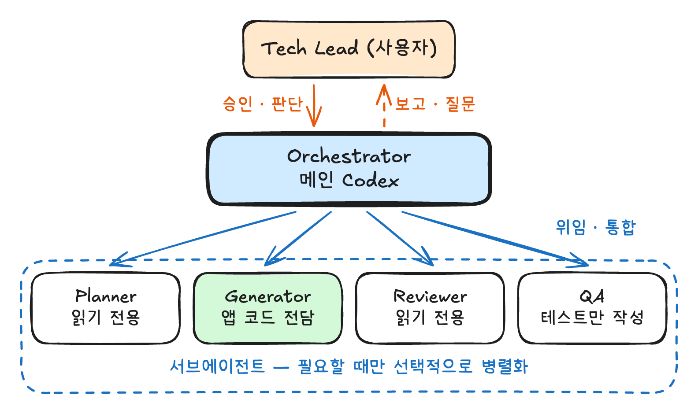
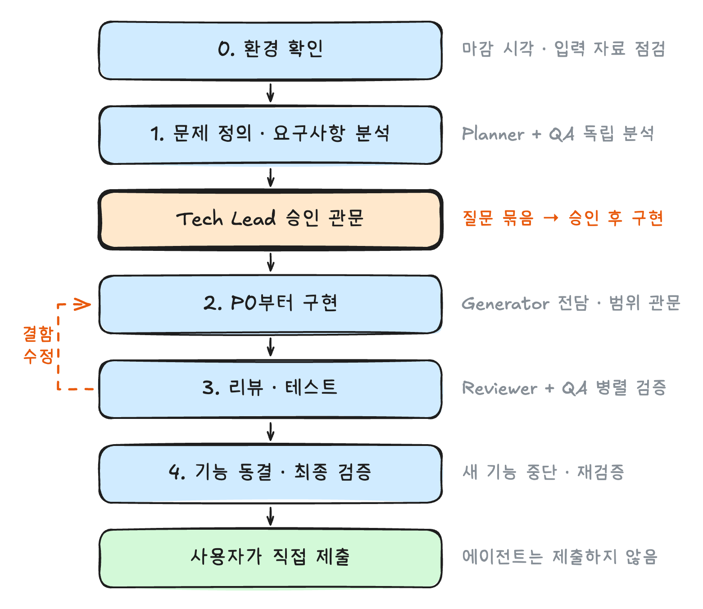

# Codex Contest Agent Kit

제한 시간 안에 **README 명세를 분석하고 웹 애플리케이션을 구현·검증**하기 위한 Codex 멀티 에이전트 스타터 킷입니다.

> Orchestrator는 메인 Codex가 담당하며, **Planner / Generator / Reviewer / QA** 네 역할을 서브에이전트로 분리합니다. 네 역할을 무조건 동시에 돌리지 않고, 작업 의존성에 따라 선택적으로 병렬화합니다.

## 한눈에 보기

### 구조: 누가 무엇을 맡는가



- **Tech Lead(사용자)**: 문제 정의와 우선순위를 승인하고, 모호한 조건을 판단합니다.
- **Orchestrator(메인 Codex)**: 범위와 우선순위를 관리하고, 서브에이전트에 위임한 결과를 통합합니다.
- **서브에이전트**: 앱 코드를 고치는 것은 Generator뿐입니다. Planner와 Reviewer는 읽기 전용이고, QA는 지정된 테스트 파일만 작성합니다.

### 워크플로우: 어떤 순서로 진행되는가



승인 관문 전에는 코드를 수정하지 않습니다. 구현과 검증은 결함이 나오면 되돌아가는 루프이고, 기능 동결 시각이 되면 새 작업을 멈춥니다. 최종 제출은 항상 사용자가 직접 합니다.

## 가장 간단한 사용법: 프롬프트만 복사 (추천)

**대회 플랫폼 안에서 바로 개발할 때는 설치가 필요하지 않습니다.**

1. [START_CONTEST.md](prompts/START_CONTEST.md)를 엽니다.
2. 대회 프로젝트의 README가 열려 있는 AI 코딩 플랫폼에 **프롬프트 본문만** 복사해 붙여넣습니다.
3. 플랫폼이 멀티 에이전트를 지원하면 Planner / Generator / Reviewer / QA를 실제로 활용하고, 지원하지 않으면 역할별 절차를 단일 에이전트가 수행합니다.
4. **문제 정의(사용자·성공 기준·만들지 않을 것), 구현 우선순위·설계안, 마일스톤을 먼저 확인하고 승인하세요.** 오케스트레이터가 우선순위를 바꿀 만한 질문을 먼저 묻습니다. 승인 전에는 애플리케이션 구현을 시작하지 않도록 구성되어 있습니다.

이 방식은 `$contest-webapp` Skill이나 별도의 TOML 설정 설치를 요구하지 않습니다. **아래 설치 절차는 Codex 에이전트를 반복 사용하고 싶을 때만 선택적으로 활용하세요.**

## 1. 선택 사항: Codex 에이전트·Skill 설치 (macOS / Linux)

```bash
git clone https://github.com/77romin/agent-skills.git
cd agent-skills
bash scripts/install.sh
```

설치되는 파일:

- `agents/*.toml` → `~/.codex/agents/` (4개 서브에이전트 정의)
- `.agents/skills/contest-webapp/` → `~/.agents/skills/contest-webapp/` (Skill)

기존 파일이 다르면 **타임스탬프 백업 후** 교체합니다. `~/.codex/config.toml` 및 기존 전역 `AGENTS.md`는 변경하지 않습니다. 설치 후 Codex를 다시 시작하세요.

```bash
bash scripts/check-setup.sh
```

`codex`/서브에이전트 기능은 설치한 Codex 버전·환경에 따라 지원 여부가 다를 수 있습니다. 설치 스크립트는 Codex 실행 파일이나 권한 설정을 자동 설치·수정하지 않습니다.

## 2. 대회 시작할 때

1. **대회 프로젝트 폴더**에서 Codex를 시작하세요. (`agent-skills` 저장소가 아니라 문제의 README가 있는 폴더입니다.)
2. `prompts/START_CONTEST.md`의 본문을 복사해 Codex에 전달하세요. 또는 `$contest-webapp`을 명시적으로 호출해도 됩니다.
3. **마감 시각**·제출 방법·필수 기술 스택을 처음 지시할 때 함께 제공하세요. 마감 시각이 없으면 오케스트레이터가 한 번 묻습니다.
4. 초기에 Planner와 QA를 독립적으로 실행해 **문제 정의**, 요구사항 추적표·테스트 기준·권장 설계안을 작성합니다. 자료(문서·데이터)가 주어지는 과제라면 설계 전에 **입력 자료 점검**(파일 수, 읽기 가능 여부, 누락)을 먼저 합니다.
5. **분석 결과를 본인이 검토하고, 문제 정의와 만들지 않을 것, 기술적 방향과 P0 우선순위, 마일스톤과 기능 동결 시각을 승인하거나 수정합니다. 승인 전에는 코드를 구현하지 않습니다.**
6. 승인 후 Generator가 **P0 핵심 사용자 흐름부터 수직 슬라이스**로 구현하고, Reviewer/QA가 독립 검증합니다. 경미한 수정은 자율적으로 진행하되, 중요 설계 변경이나 P0 포기는 다시 보고합니다. **승인된 목록에 없는 작업**(새 기능, 눈에 띄는 빈칸)은 우선순위와 예상 비용을 달아 기록한 뒤에만 착수하고, P2는 백로그에 둡니다.
7. 마지막에는 새 기능 추가를 멈추고 **실행·빌드·핵심 흐름·제출 조건**을 확인합니다. 최종 제출은 본인이 직접 합니다.

대회 프로젝트에 규칙을 고정하려면 `templates/CONTEST_AGENTS.md` 내용을 **해당 프로젝트의** `AGENTS.md`로 복사하세요. 이미 파일이 있다면 덮어쓰지 말고 병합하세요. 이 저장소 자체에는 설치용 `AGENTS.md`를 강제로 넣지 않습니다.

## 3. 역할 및 소유권

| 역할 | 담당 | 앱 코드 수정 |
| --- | --- | --- |
| Orchestrator (메인 Codex) | 우선순위·위임·충돌 방지·통합·최종 판정 | 필요 시 |
| Planner | README 요구사항 ID, P0/P1/P2, 데이터/API 계약, 구현 순서 | 금지 |
| Generator | 기능 구현·테스트·오류 수정 | **전담** |
| Reviewer | 명세 미준수·동시성·보안·상태 전이·회귀 위험 분석 | 금지 |
| QA | 독립 테스트 설계·API/E2E·경계값/동시성 검증 | 앱 코드 금지 |

- **Planner + QA**: 서로의 분석을 복사하지 않고 README 원문을 각자 읽습니다.
- **Generator**: 초기 실행 가능한 앱을 먼저 만들고, 기능 단위로 테스트합니다.
- **Reviewer + QA**: 구현 결과를 병렬 검토할 수 있으나 애플리케이션 코드는 수정하지 않습니다.
- 검증 실패는 Generator에게 돌리고, 수정 후 관련 테스트를 다시 실행합니다.
- 추가 Generator나 Git Worktree는 **파일 소유권이 분리될 때만** 고려합니다.

## 4. tmux (선택)

```bash
# macOS: brew install tmux
bash /path/to/agent-skills/scripts/tmux-contest.sh /path/to/contest-project
```

`contest` 세션에 `codex`, `server`, `test` 창을 마련합니다. 각 창은 **빈 셸**이며 서버나 코드를 자동 실행하지 않습니다. tmux는 프로세스/로그 관리 도구이고, Codex 서브에이전트 오케스트레이션과는 별개입니다.

별도 창에 에이전트 세션을 더 띄울 때는 **범위와 우선순위의 결정권을 오케스트레이터 한 곳에 둡니다.** 추가 세션은 읽기 전용이거나 겹치지 않는 파일만 맡기고, 새 제안은 오케스트레이터를 거쳐 반영합니다. 창을 늘리는 것 자체가 속도를 올려 주지는 않습니다.

## 5. 파일 구성

```text
agent-skills/
├── README.md
├── docs/                      # README 그림
│   ├── architecture.png
│   └── workflow.png
├── agents/
│   ├── planner.toml
│   ├── generator.toml
│   ├── reviewer.toml
│   └── qa.toml
├── .agents/skills/contest-webapp/
│   ├── SKILL.md
│   └── references/edge-case-checklist.md
├── prompts/START_CONTEST.md
├── templates/CONTEST_AGENTS.md
└── scripts/
    ├── install.sh
    ├── check-setup.sh
    └── tmux-contest.sh
```

## 6. 설계 원칙

- **문제 정의 우선**: 기술을 고르기 전에 누구의 어떤 문제인지, 무엇이 되면 성공인지, 무엇을 만들지 않을지를 먼저 정합니다.
- **명세 우선**: README에 없는 기능을 그럴듯하게 만들어 점수를 잃지 않습니다.
- **자료 먼저 확인**: 주어진 자료가 빠짐없이 읽혔는지는 마지막이 아니라 처음에 확인합니다.
- **범위 통제**: 눈에 띄는 빈칸과 중요한 문제는 다릅니다. 계획 밖 작업은 우선순위를 매긴 뒤에만 합니다.
- **실행으로 검증**: 테스트하지 않은 성공은 성공이 아닙니다. 실행 불가능한 테스트는 BLOCKED로 표시합니다.
- **과도한 병렬화 금지**: 동시 수정 충돌보다 한 기능의 끝까지 동작을 보장하는 편이 낫습니다.
- **안전한 설치**: 백업·명시적 설치·낮은 권한을 기본으로 합니다.
- **제출 우선**: 마일스톤과 기능 동결 시각을 시작할 때 정하고, 최종 검증/제출 시간을 따로 확보합니다.

## 참고

- [Codex 개발 문서](https://developers.openai.com/codex/)
- [Agent Skills 가이드](https://developers.openai.com/api/docs/guides/tools-skills)
- [Git worktree 문서](https://git-scm.com/docs/git-worktree)

이 저장소는 검증 절차와 설정 파일을 제공하는 **템플릿**입니다. 실제 대회 문제의 실행 명령·테스트·채점 기준은 README와 현장 환경에 맞춰 조정해야 합니다.
